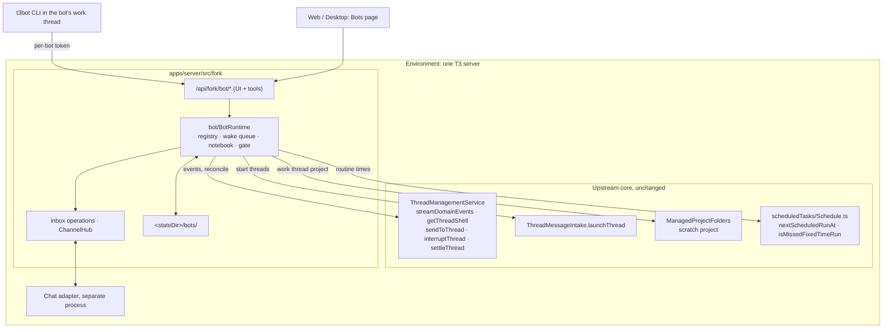

# Bot architecture (draft)

How the bots in [bot.md](./bot.md) are built. Status: design draft for sign-off.

The rule is the inbox's rule: the core does not know bots exist. Bots live in fork-only
directories, call existing service methods, and add no contracts, no main-database tables, and no
upstream MCP tools. A rebase onto upstream should touch the same seams the inbox already has.

## Where it sits



## Upstream footprint

| Upstream file                                        | Change                                       | New?          |
| ---------------------------------------------------- | -------------------------------------------- | ------------- |
| `apps/server/src/server.ts`                          | none: bots merge into `fork/layer.ts`        | existing seam |
| `apps/web/src/components/sidebar/SidebarChrome.tsx`  | none: Bots joins `<ForkSidebarItems>`        | existing seam |
| `apps/web/src/components/sidebar/mainAppLocation.ts` | `/bots` is a sidebar utility page, one line  | extends seam  |
| `apps/web/src/routes/_chat.bots.tsx`                 | new thin route file                          | new file      |
| `apps/web/src/routeTree.gen.ts`                      | regenerated                                  | generated     |

Bots have no Settings page and no component in the thread view: permissions, budget, pause, and
Hand back all live on the Bots page, so neither needs another route or a slot in upstream views.
Everything else is new files under `apps/server/src/fork/bot/` and `apps/web/src/fork/bot/`, plus
fork-only edits: `ForkSidebarItems` shows Bots even when no chat channel is configured, and
`ChannelHub` passes the event's `conversationId` to server-side subscribers.

Upstream modules are imported, never edited: `ThreadManagementService`, `ThreadMessageIntake`,
`ManagedProjectFolders`, and the pure `nextScheduledRunAt` and `isMissedFixedTimeRun`.

## Server

`apps/server/src/fork/bot/`, provided by `fork/layer.ts` beside the inbox:

| File          | Does                                                                                   |
| ------------- | -------------------------------------------------------------------------------------- |
| `store.ts`    | `bots.sqlite`: bots, goals, items, routines, memory, chat, threads, questions, queue    |
| `notebook.ts` | `role.md` per bot; renders the notebook for the wake packet                            |
| `events.ts`   | Follows `streamDomainEvents` and `ChannelHub`; turns them into queued bot events        |
| `reconcile.ts`| On startup, reads every bot-owned thread's shell and queues what was missed            |
| `wake.ts`     | Per-bot queue, coalescing, one turn at a time, budget, pause, work-thread rotation     |
| `packet.ts`   | Pure: builds the wake packet from notebook, recent chat, and the event digest           |
| `gate.ts`     | Pure: permission and ownership decision for one action                                  |
| `actions.ts`  | Runs an allowed action through the service methods above or the inbox's `send`          |
| `routines.ts` | One timer per bot for its next routine, from `nextScheduledRunAt`                       |
| `http.ts`     | Routes for the UI and for the CLI; decode, one operation, map errors                    |
| `cli.ts`      | The `t3bot` tool CLI source, and writing it to `bots/bin/` at startup                   |

### On an installed T3

An environment with no bots runs none of this: the runtime opens `bots.sqlite`, starts its event
subscription, timers, and reconcile, and writes the CLI only once the first bot is created, and
stops them when the last one is deleted. Installing a build with bots therefore changes nothing
until the user creates one.

What a bot adds to T3's own state is ordinary: its work thread in the scratch project and the
worker threads it starts, created through the same service methods as any thread, plus the
provider usage of their turns. Everything bot-specific lives in `<stateDir>/bots/`. Downgrading
to a build without bots, or to upstream, leaves that folder unread and its threads as plain
threads; deleting the folder removes the bots.

### State

`<stateDir>/bots/`, beside `<stateDir>/channels/`:

```text
bots/
  bots.sqlite
  <botId>/
    role.md        # the bot's role and rules, prose the user and the bot both edit
    token          # per-bot tool token, mode 0600
  bin/t3bot        # the tool CLI, written by the server at startup
```

`bots.sqlite` holds what has structure: `bots` (name, model, permissions, budget, skills,
scope, paused), `goals`, `items` (goal, status, next step, waiting on, last touched, set
aside), `routines` (schedule, prompt, next due), `memory` (one row per note; their total is
capped at 4 KB), `threads` (thread id, bot, item, follow-up mode,
role `work` or `worker`, handed-back marker), `chat` (the bot's conversation with the user),
`questions` (pending asks, the exact action each one would run, and when it expires), `queue` (events not yet
given to a turn), `turns` (the running turn's run id and its packet), and `followed`
(conversation, last seen message).

Writes from the UI and from the bot use the same operations. The last write wins per field; any
user edit queues a `notebook.edited` event so the next turn sees it.

### Events into a bot

`events.ts` reduces everything to one internal type, `BotEvent`, and writes it to the owning
bot's `queue`. Nothing here starts a turn; `wake.ts` decides.

| Source                                                         | Becomes                                   |
| -------------------------------------------------------------- | ----------------------------------------- |
| `run.updated` to a terminal status on a bot's worker thread    | `thread.stopped` (completed, failed, interrupted) |
| a pending approval or user-input request on a bot's thread     | `thread.needs` (always wakes)             |
| `thread.pull-request-synced`, `thread.pull-request-link-updated` on a bot's thread | `thread.pr` (by follow-up mode) |
| a message from the user on a bot's thread (see Ownership)      | ownership moves to the user; no wake      |
| the user presses Hand back                                     | `thread.returned` (always wakes)          |
| a hub event naming a followed conversation                     | read new messages past `followed`, skip `isSelf` authors, then `chat.message` |
| a user message in the bot's chat, a notebook edit              | `user.message`, `notebook.edited` (always wake) |
| a routine timer, or Run now on the Bots page                   | `routine.due` with its due time (always wakes) |
| a question with an action passing its expiry                   | `question.expired` (waits for the next wake) |

Events for threads that no bot owns are dropped at the first lookup, so a busy environment costs
one map lookup per event. Message streaming events are filtered out before that, as the inbox
already does in `linkedThreads.ts`. The bot's own work thread produces no events for itself.

`ChannelHub` is changed (fork code only) to hand its server-side subscribers the adapter event's
`conversationId` when it has one, so a bot reads only the conversations named, not every followed
conversation on every read-state or delegation change. An event without a conversation id reads
the channel's followed conversations once, coalesced per channel.

### Restart and recovery

`streamDomainEvents` starts at the latest event and does not replay, so events while the server
was down are not delivered. The queue, the running turn, and pending questions are in
`bots.sqlite`, and on startup `reconcile.ts`:

1. Reads the shell of every bot-owned thread with `getThreadShell` and queues a `thread.stopped`
   or `thread.needs` for any whose state differs from what the bot last saw.
2. For a bot whose recorded turn is no longer running, marks it idle and keeps its queue; the
   recorded packet's events are queued again, since the turn may not have finished them.
3. Runs each routine whose due time passed while the server was down once, using
   `isMissedFixedTimeRun`, not once per missed slot. Its `routine.due` carries the latest
   missed due time, which the packet shows beside the time now.
4. Expires questions whose time passed while the server was down.

### Ownership

- `threads` maps a thread to one bot. A thread not in it is not a bot's.
- The bot service sends with `createdBy: "system"`. A thread is the user's when its latest user
  message after the handed-back marker has `createdBy: "user"` and none of `notification`,
  `delegatedCompletion`, or `idleCompaction`. Those three are messages T3 writes with the user
  role, and must not count as the user taking over.
- Hand back records the latest message id as the handed-back marker.
- `gate.ts` refuses `send`, `interrupt`, and `settle` on any thread not owned by the calling bot,
  or owned but currently the user's, and checks again right before dispatch. A user message that
  lands between that check and dispatch is a short race the design accepts; the user's message
  still arrives and the thread becomes the user's from then on.
- Settling a thread also stops its pull request watches, so the bot settles a worker thread only
  when its item is done.

### The wake loop

`wake.ts` keeps, per bot, a state: `idle`, `running(runId)`, or `paused`.

1. An event arrives. If it wakes now (see the follow-up modes in [bot.md](./bot.md)) and the bot
   is idle, not paused, and within budget, start a turn. Otherwise leave it queued, except a
   `user.message` while the bot is running: it is sent to the work thread with `mode: "steer"`,
   which joins the running provider turn, and recorded on the turn as answered by it. If T3
   reports no steerable turn (the run has not reached the provider yet, or is ending), it stays
   queued for the next turn.
2. A turn: take the whole queue, build the packet, record both in `turns`, then `sendToThread`
   to the bot's work thread with `createdBy: "system"`, `creationSource: "server"`, and the
   message id chosen by the service so a retried dispatch is the same message.
3. The turn's `run.updated` to a terminal status sets the bot idle and clears `turns`. If events
   queued meanwhile, go to 2.
4. If the turn answered a `user.message`, including a steered one, and called neither
   `t3bot say` nor `t3bot ask`, the service posts the turn's last assistant message to the chat,
   so a forgetful model still answers without repeating a question card. A turn with no user
   message posts only what it `say`s, so a wake with nothing new stays silent.
5. A failed turn is retried once with the same packet; a second failure posts an error to the
   bot's chat and leaves the queue for the next wake.

**One work thread per bot.** It is launched once, in the scratch project so it has no project,
and stays. When it grows past a message limit, or on the first turn of a new day, the turn is sent
with `freshContext: true`, which starts a new provider session in the same thread. Nothing is
lost, because every packet starts from the notebook. The thread never needs settling and adds one
row to the sidebar per bot.

Between rotations the provider session carries over, so earlier turns are a cached prefix and a
turn's new input is its packet. The notebook is repeated in every packet, which the size caps
keep to a few thousand tokens. A wake after the provider's cache lifetime, and the first turn
after a rotation, miss the cache; per-wake fresh sessions would miss it every time, which is
why rotation is by size or day.

The work thread runs in `auto` mode: it must run the `t3bot` CLI from its shell, and Claude
refuses `full-access` when T3 runs as root. Its model is the bot's model.

The scratch project is unavailable when T3's base directory is inside a Git checkout, which is
the default for a dev worktree. Develop bots with `--home-dir` outside the checkout.

**Limits.** Each bot has a budget: turns per day, concurrent worker threads, and retries per
step. The packet has a hard size cap: the notebook is cut to its open items, the chat to the
last 10 messages, and the event digest to one line per event with a count for the rest. A paused
bot keeps queuing events and runs nothing until resumed.

**Keeping the notebook small.** An item's last-touched time moves whenever the bot or the user
edits it or one of its threads produces an event. On the first turn of a day, the packet lists
open items untouched for 7 days under "Stale". Items untouched for 14 days are set aside by the
service: dropped from the packet and the main list, readable with `t3bot item list --all`,
reopened by the user on the Bots page or by the bot with `item edit`. `memory add` and
`memory edit` fail with the current total when they would pass 4 KB.

### The wake packet

Built by `packet.ts`, a pure function, so it is unit-tested without a server:

```text
You are {name}. {role.md}
How to act: only through `{bots/bin/t3bot} --bot {id}` (`help` lists commands). Write down
anything you must remember with the notebook commands before you stop; your conversation here is
reset often. A thread that waits on an approval is for the user: tell them with `say`.
Post with `say` only what is new or needs the user; when nothing is, stop without posting.
Memory is one fact per line: rewrite a note that changed, remove one that no longer holds.
Skills: {name}: {path}/SKILL.md — read one when it applies.

Goals and items: …        Routines: …        Scope: …        Memory: …
Stale (first turn of the day): #7 "Android 0.1.11 build", untouched 9 days
Recent chat with the user (last 10): …
What happened since your last turn:
- routine "PR and CI check" was due 09:00, now 11:40
- #12 thread "fix: ReplyBox typecheck" completed
- your question "merge #412?" expired unanswered; its action did not run
- the user: "how is the Android build going?"
```

Skills are named by path, not installed, so they work the same with every provider and need no
change to provider skill discovery. Transcripts, chat history, and diffs are not included; the bot
reads them with paged tool calls.

### Tools

The bot's only tool surface is the `t3bot` CLI, run from the work thread's shell. It ships inside
the fork, not as a separate install: at startup the server writes `<stateDir>/bots/bin/t3bot`, a
small Node script that runs with the server's own Node (`process.execPath`, with
`ELECTRON_RUN_AS_NODE=1` in desktop). The wake packet gives its absolute path. Each run reads the
server's current port from `<stateDir>/server-runtime.json`, because desktop binds a dynamic port
that is not known when the fork layer is built. So the CLI always matches the running server and
needs no configuration. It calls `/api/fork/bot/*` with `Authorization: Bearer <bots/<id>/token>`.

```text
t3bot say <text>                        reply in the chat with the user
t3bot ask <question> [--action <json>]  ask the user; with an action, approving runs it
t3bot goal|item|routine add|edit|done   notebook
t3bot item list [--all]                 --all includes set-aside items
t3bot memory add <text> | edit <id> <text> | remove <id>
                                        one note at a time, 4 KB in total
t3bot role edit -                       whole role via stdin; gated, see below
t3bot thread start --item N --project P --follow now|attention|routine
                   [--worktree] [--provider I] [--model M] -
t3bot thread send|interrupt|settle <thread>
t3bot thread read <thread> [--page]     any thread in scope, paged
t3bot chat read <conversation> [--page]
t3bot chat send <conversation> -        through the gate; the card shows the message as drafted
```

Each call is one HTTP request and one service operation, and the CLI never waits on a turn.
`--provider` and `--model` default to the bot's own; any provider instance the environment has
is accepted, which is how development runs worker threads on `Replay (dev)`.
`--worktree` starts the thread in its own worktree, so parallel worker threads do not edit the
same checkout. Using MCP instead would need new tools in the upstream MCP toolkit, which this
design avoids.

### Permissions

`gate.ts` returns `allow`, `ask`, or `deny` for (bot, action, target). Only actions the service
performs are gated, because those are the only ones it can stop:

| Action                                        | Default |
| --------------------------------------------- | ------- |
| reads in scope, `say`, goals, items, routines, memory | allow |
| edit its role                                 | ask     |
| start a thread in `auto` mode, within budget  | allow   |
| start a thread in `full-access` mode          | ask     |
| send, interrupt, settle its own threads       | allow   |
| send in a followed conversation               | ask     |
| anything over budget                          | ask     |
| message a thread it does not own              | deny    |
| change its own permissions                    | deny    |

`ask` stores the exact action in `questions` and shows it as a card in the bot's chat. Approving
claims the question once, checks ownership, scope, and budget again, runs that stored action (not
a new one from the model), records the result, and queues `question.answered`. A question with
an action expires 24 hours after it is asked; one timer per bot for the earliest expiry marks it
expired and queues `question.expired`, and approving an expired card is refused. Questions
without an action never expire.

Each bot has one long-lived tool token, created with the bot and replaced only when the user
resets it. The gate bounds the tool API, not the operating system. The work thread and worker threads have
shell access under their runtime mode, run as the same OS user as the server, and could read
another bot's token or the database. That is the trust boundary on a single-user machine, and the
reason per-turn tokens would add nothing. What a
thread does in its own shell (push, merge, release) is limited by its runtime mode and branch
protection, and guided by the role.

### Chat

Sending reuses the inbox's `send` operation with the user's identity, and the service appends the
signature. New messages from authors with `isSelf` are never turned into bot events. That avoids
the race where the adapter's event, or the inbox's own refresh, arrives before `send` returns the
new message id. The cost is that the user's own messages in a followed conversation do not wake
bots; the user talks to a bot in its chat.

A mention of a bot is matched as its name in the text, only inside followed conversations. The
chat app has no bot member, so a bot cannot be mentioned anywhere else.

## Web

`apps/web/src/fork/bot/`, reached through the existing fork seams plus `_chat.bots.tsx`:

- **Bots page**: bot list, chat, and notebook panel. The chat reuses the inbox's message list and
  `ReplyBox`; the notebook renders goals, items with their threads, routines, scope, and memory.
  Each bot's permissions, budget, and pause switch are a panel of the same page.
- **Hand back**: shown on the item whose thread the user has taken over. The thread view stays
  unaware of bots, as it stays unaware of the inbox.
- **Inbox bridges**: a bot target in the delegate dialog (creates an item with the messages'
  link), and a follow action in the conversation header (adds to `followed`).
- **Live updates**: one SSE stream, `/api/fork/bot/events`, that only says a bot changed; the
  client refetches, as the inbox does.

Mobile has no Bots UI in v1. Bot threads and their approval requests still show in mobile like
any thread.

## Tests

Pure parts carry the logic and get unit tests beside them: `packet.ts` (including the size cap),
`gate.ts`, the ownership rule (each of the three T3-written message kinds must not take over),
the follow-up rules in `wake.ts` (including steering a `user.message` and falling back to the
queue when nothing is steerable), stale and set-aside items, the memory cap, question expiry,
and event reduction in `events.ts` (fed a stream of domain events). The store gets the inbox's style of temp-dir tests. Integration tests drive a fake event
stream through a wake and assert the dispatched packet and the ownership switch, and restart a
runtime mid-turn to assert that reconcile requeues what was missed, using the effect-worker drain
rather than sleeps.

### Trying it locally

A dev bot must never reach the T3 the developer is using, its data, or a real chat app:

- **Own state, outside the checkout.** Run `vp run dev --home-dir <dir>` with a directory outside
  any Git checkout (the scratch project refuses one inside), seeded with
  `vp run migrate-dev-db --base-dir <dir>`. Unset inherited `T3CODE_HOME`, `T3CODE_PORT`, and
  `T3CODE_HOST` first. The CLI the dev server writes reads that directory's
  `server-runtime.json` and holds that directory's tokens, so a dev bot can only call the dev
  server.
- **Throwaway projects.** Seeded projects point at real checkouts, and a worker thread there can
  edit or push. Point dev bots only at a scratch Git repository made for the test.
- **Free worker threads.** The bot's own turns need a real model to run the CLI; use the cheapest
  one. Worker threads use `--provider devReplay --model showcase`, which produces completion,
  tool-call, and approval events without cost or file changes.
- **The example channel.** Followed conversations come from the built-in example channel, never
  the real chat adapter, which would send as the user.
- **No waiting.** Routines are tried with Run now; restart recovery by stopping the dev server by
  its own PID and starting it again.

## Build order

1. Store, notebook, routes for the UI, and the Bots page with chat. A bot can be created and
   talked to; each message runs one turn in its work thread. No worker threads yet.
2. Tools and the wake loop: `say`, notebook commands with stale items and the memory cap,
   routines with late-start times, steering, rotation with `freshContext`, pause, budget,
   restart recovery.
3. Worker threads: `thread start/send/read`, ownership, follow-up modes, PR events, Hand back.
4. Chat: followed conversations, `chat send` through the gate, signature, `isSelf` filtering,
   inbox bridges.
5. Questions with expiry, and the permissions panel.

Each step is usable on its own and ships as `feat(bot)` commits, with the seams in one
`fork(bot): wire seams` commit, as the inbox does.

## Open points

- Whether a bot may answer a worker thread's plain question itself (`t3bot thread answer`),
  escalating only approvals to the user. Until decided, every `thread.needs` goes to the user.
  The cost to the work thread is the question and the answer, plus whatever of the worker's
  transcript the bot pages in to answer well; the worker gets one answer message, as it would
  from the user. The real risk is a wrong answer the user never sees, so each answer would also
  be one line in the bot's chat.
