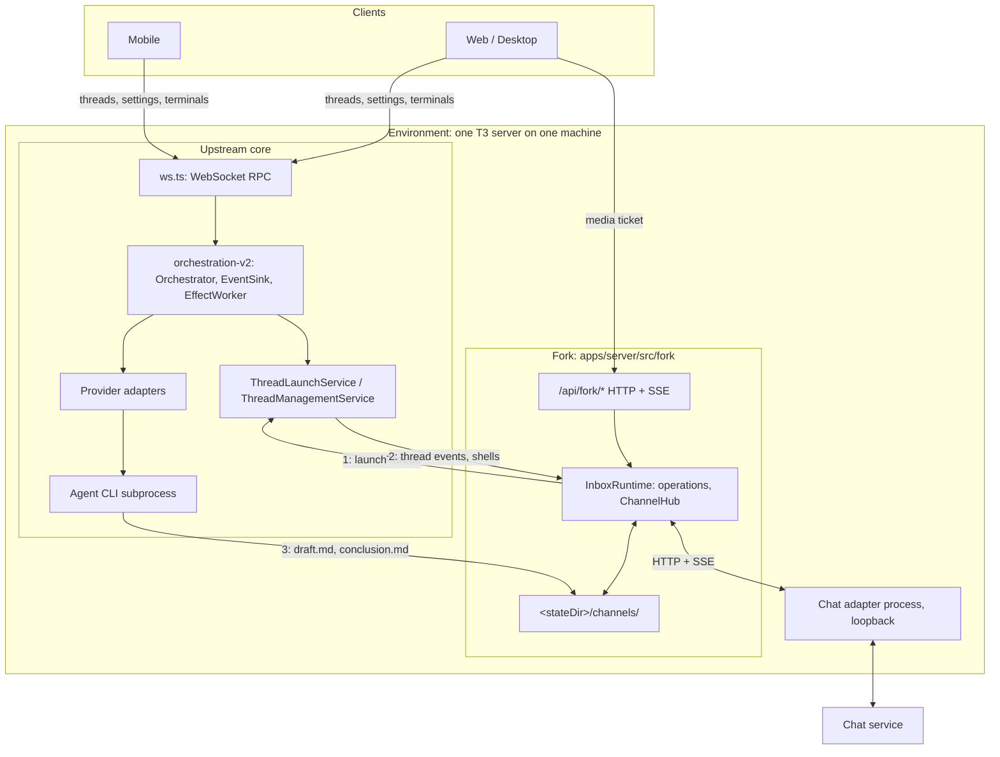

# Inbox architecture

How the inbox and its channels sit in T3 Code, and how a request moves through them. The adapter
API is in [channel-protocol.md](./channel-protocol.md); seams, sync steps, and delegation rules are
in [FORK.md](../../FORK.md#inbox-and-channels).

## Where it sits



- **Channels belong to an environment.** An adapter only listens on loopback, so it runs on the
  same machine as the T3 server. A remote client (another browser, app.t3.codes, a tunnel) sees
  the inbox of the environment it is connected to.
- **The core does not know the inbox exists.** There are three touchpoints:
  1. The inbox starts an ordinary thread with `ThreadMessageIntake.launchThread`.
  2. It follows `streamDomainEvents` for run, archive, and delete events, and reads
     `getThreadShell` and `getThreadRecords` when it fetches.
  3. The agent reports back through files in the thread's context folder.
- **No WebSocket RPC, no contracts.** Plain HTTP routes keep upstream syncs cheap. Because of
  this, the inbox has no shared client types and no MCP tools, and only web and desktop have a
  UI. Mobile could use the same routes and the same media ticket.

## Layers

| Layer   | Web (`apps/web/src/fork`)                                    | Server (`apps/server/src/fork`)                                       |
| ------- | ------------------------------------------------------------ | --------------------------------------------------------------------- |
| Seam    | sidebar, settings nav and search, two route files            | `server.ts` → `layer.ts` (routes, linked threads, `InboxRuntime`)     |
| Entry   | `InboxPage`, `TopicDetail`, `DelegateDialog`, settings panel | `http.ts`: auth scope, one operation, error mapping                   |
| Logic   | `useForkResource`, `inboxView.ts`                            | `inbox/operations.ts`; pure `derive.ts`, `context.ts`, `artifacts.ts` |
| State   | one SSE stream per environment                               | `InboxRuntime.ts` (hub, `store.ts`, `fs.watch`), `linkedThreads.ts`   |
| Channel | —                                                            | `channels/hub.ts`: per-channel status, cache, paging, last good data  |
| Wire    | `forkApiAccess.ts`: per-environment address and media ticket | `channels/transport.ts`, `protocol.ts`; example channel in process    |

## One request: listing the inbox

```mermaid
sequenceDiagram
  participant UI as InboxList / useForkResource
  participant R as http.ts
  participant O as operations.readChannelItems
  participant H as ChannelHub
  participant A as Adapter

  UI->>R: GET /api/fork/inbox/items?channelId (media ticket)
  R->>O: authenticate read scope, provide InboxRuntime
  O->>H: getAllPages(conversations), then topics per conversation
  H->>H: status allows reading? 20 s cache hit? same read in flight?
  H->>A: GET with Bearer token, 10 s timeout
  A-->>H: page {items, nextCursor}
  Note over H: Decode items one by one and skip bad ones.<br/>When the adapter is unreachable, serve the last good answer (stale).
  H-->>O: conversations, topics
  O->>O: merge marks, links, and thread folders; deriveItem, compareItems
  O-->>UI: items, newest first
```

The list is ordered by `lastMessageAt` alone, newest first; the views already split items by
state. The other routes go through the same layers. `conversation` reads one page of a
conversation's messages for the chat view, unlike `topic`, which reads every page of one topic.
`delegate` ends in `launchThread`, in the checkout the dialog chose; `ask` ends in
`sendToThread` on the topic's current thread, queued behind a running turn, and never reaches the
adapter; `send` ends in the adapter's `POST /messages`.

## Change signals

Nothing pushes data to the browser. Every source below only says that a channel changed, as
`{ type: "inbox", channelId }` on `/api/fork/inbox/events`. The client waits 250 ms, then fetches
again.

| Source                                                              | Raised by                    |
| ------------------------------------------------------------------- | ---------------------------- |
| Adapter `/events` (any event, or a reconnect)                       | `ChannelHub.onEvent`         |
| Channel status or health changed                                    | `ChannelHub.check`           |
| Only `lastSyncAt` moved (sent as `{ type: "sync" }`)                | `ChannelHub.check`           |
| A thread wrote to its context folder (300 ms debounce)              | `fs.watch` in `InboxRuntime` |
| A linked thread's run status changed, or it was archived or deleted | `linkedThreads.ts`           |
| Save, remove, delegate, ask, send, or mark                          | the operation itself         |

Item state is derived on fetch. Requests for one channel share a derivation until the hub's
`revision` for it moves (any signal above except `sync`) or it is 10 s old, so a missed signal is
fixed by the next one, or by the client's 60 s poll while the page is visible. Wait times are not
sent: the client works them out from `lastMessageAt`, so an unchanged list keeps its ETag and the
browser's revalidation gets a 304. `inbox.sqlite` stores only what cannot be derived:
done and ignored marks, and links between topics and threads.
