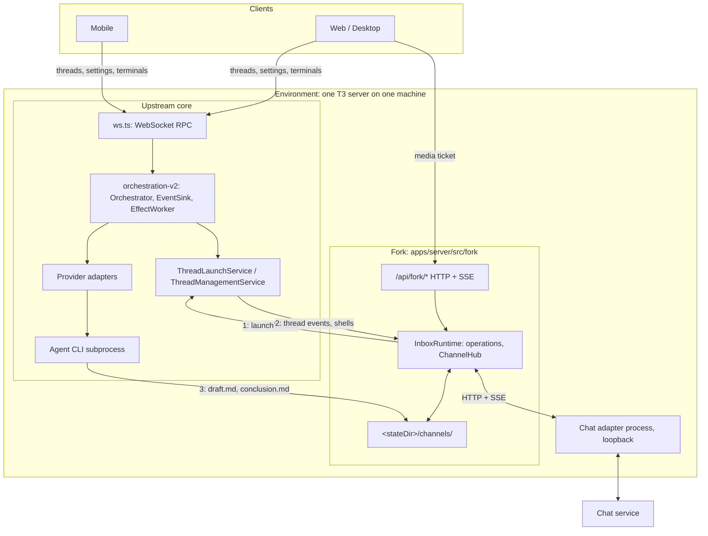
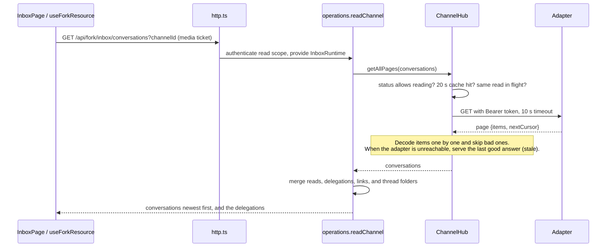

# Inbox architecture

How the inbox and its channels sit in T3 Code, and how a request moves through them. The adapter
API is in [channel-protocol.md](./channel-protocol.md); seams, sync steps, and delegation rules are
in [FORK.md](../../FORK.md#inbox-and-channels). How the UI should look and behave is in
[inbox-design.md](./inbox-design.md).

## Where it sits

- **Channels belong to an environment.** An adapter only listens on loopback, so it runs on the
  same machine as the T3 server. A remote client (another browser, app.t3.codes, a tunnel) sees
  the inbox of the environment it is connected to.
- **The core does not know the inbox exists.** There are three touchpoints:
  1. The inbox starts an ordinary thread with `ThreadMessageIntake.launchThread`.
  2. It follows `streamDomainEvents` for run, archive, and delete events, and reads
     `getThreadShell` and `getThreadRecords` when it fetches.
  3. The agent reports back through files in the thread's context folder.
- **No WebSocket RPC, no contracts.** Plain HTTP routes keep upstream syncs cheap. Because of
  this, the inbox has no shared client types and no MCP tools, and only web and desktop have a
  UI. Mobile could use the same routes and the same media ticket.

## Layers

| Layer   | Web (`apps/web/src/fork`)                                    | Server (`apps/server/src/fork`)                                       |
| ------- | ------------------------------------------------------------ | --------------------------------------------------------------------- |
| Seam    | sidebar, settings nav and search, two route files            | `server.ts` → `layer.ts` (routes, linked threads, `InboxRuntime`)     |
| Entry   | `InboxPage`, `ConversationPane`, `DelegationPane`, dialogs   | `http.ts`: auth scope, one operation, error mapping                   |
| Logic   | `useForkResource`, `inboxView.ts`                            | `inbox/operations.ts`; pure `derive.ts`, `context.ts`, `artifacts.ts` |
| State   | one SSE stream per environment                               | `InboxRuntime.ts` (hub, `store.ts`, `fs.watch`), `linkedThreads.ts`   |
| Channel | —                                                            | `channels/hub.ts`: per-channel status, cache, paging, last good data  |
| Wire    | `forkApiAccess.ts`: per-environment address and media ticket | `channels/transport.ts`, `protocol.ts`; example channel in process    |

## One request: listing the inbox

One read of the conversation list is all the list costs; each conversation carries its own read
and mention summary. The other routes go through the same layers. `conversation` reads one page
of a conversation's messages for the chat view. `delegation` reads what a delegation covers: a
reply thread through `?root=`, or a range by paging the conversation back to its first message.
`delegate` ends in `launchThread`, in the checkout the dialog chose; `ask` ends in
`sendToThread` on the delegation's current thread, queued behind a running turn, and never
reaches the adapter; `send` ends in the adapter's `POST /messages`.

## Change signals

Nothing pushes data to the browser. Every source below only says that a channel changed, as
`{ type: "inbox", channelId }` on `/api/fork/inbox/events`. The client waits 250 ms, then fetches
again.

| Source                                                              | Raised by                    |
| ------------------------------------------------------------------- | ---------------------------- |
| Adapter `/events` (any event, or a reconnect)                       | `ChannelHub.onEvent`         |
| Channel status or health changed                                    | `ChannelHub.check`           |
| Only `lastSyncAt` moved (sent as `{ type: "sync" }`)                | `ChannelHub.check`           |
| A thread wrote to its context folder (300 ms debounce)              | `fs.watch` in `InboxRuntime` |
| A linked thread's run status changed, or it was archived or deleted | `linkedThreads.ts`           |
| Save, remove, delegate, ask, send, read, seen, or read all          | the operation itself         |

State is derived on fetch. Requests for one channel share a derivation until the hub's
`revision` for it moves (any signal above except `sync`) or it is 10 s old, so a missed signal is
fixed by the next one, or by the client's 60 s poll while the page is visible. Wait times are not
sent: the client works them out from `lastMessageAt`, so an unchanged list keeps its ETag and the
browser's revalidation gets a 304. `inbox.sqlite` stores only what cannot be derived: how far
each conversation was read, the delegations, and links between delegations and threads.

## Two layers

The inbox is a mirror of the chat app with T3 Code's own layer on top, and each fact belongs to
one of them:

- **Conversations and messages** are the chat app's. The list has one row per conversation, the
  chat view shows its messages with their reply links, and reading follows the chat app. The
  adapter reports these; T3 adds nothing the chat app does not have.
- **Delegations** are T3 Code's. A delegation is a set of messages handed to a thread: a message
  and its replies (`chain`), or a message through a later one (`range`, fixed when delegated).
  Its id hashes the channel, conversation, and first message, so delegating the same messages
  again is the same delegation with a new thread. Threads, drafts, conclusions, and whether the
  user saw the latest run belong to the delegation.

A delegation made before protocol v2 was a v1 topic. Its topic id was its first message's id, so
it kept its id and folder; it has no stored scope and reads as a reply thread, or in a DM as the
six hours from its first message that the topic was.

## Read state

A conversation is unread when someone else wrote after every read mark, or when the user pinned
it unread. It shows a mention when a message mentions me after every read mark and after my own
last message. A delegation has an unseen result when its thread finished a run after the user
last looked. Each mark moves forward only and compares with one kind of time:

- Message marks are message times: `read_at` (the newest message the client showed when the
  conversation was opened), the adapter's `selfReadThroughAt`, and the channel's
  `read_all_before`. T3 never writes a read back to the chat app: the chat app's own unread
  state is the user's reminder to check there.
- `agent_seen_at` is the run end the client showed. A run still going has no end, so opening a
  delegation mid-run leaves the run's result unseen once it finishes. Stopped, cancelled, and
  rolled-back runs and background-work wakes have nothing new and do not count.
- `read_all_before` starts a week before the channel is first read, so connecting a channel does
  not flood the list, and "Mark all as read" moves it. It also covers run ends.

The client reports reads; fetching never does, since polls and background tabs fetch too. A
message that arrives while a conversation is open stays unread until the user acts on it again.
The sidebar badge counts unread DMs, groups with an unread mention, and unseen agent results;
groups with only new messages show in Unread but are not counted. It means "waiting on me".

The Unread view follows the chat app instead: a muted conversation shows there only when it
mentions me, and the tab counts unread messages, using the adapter's `unreadCount` and 1 when it
has none. A muted conversation counts only its mention. All lists muted conversations as usual.
